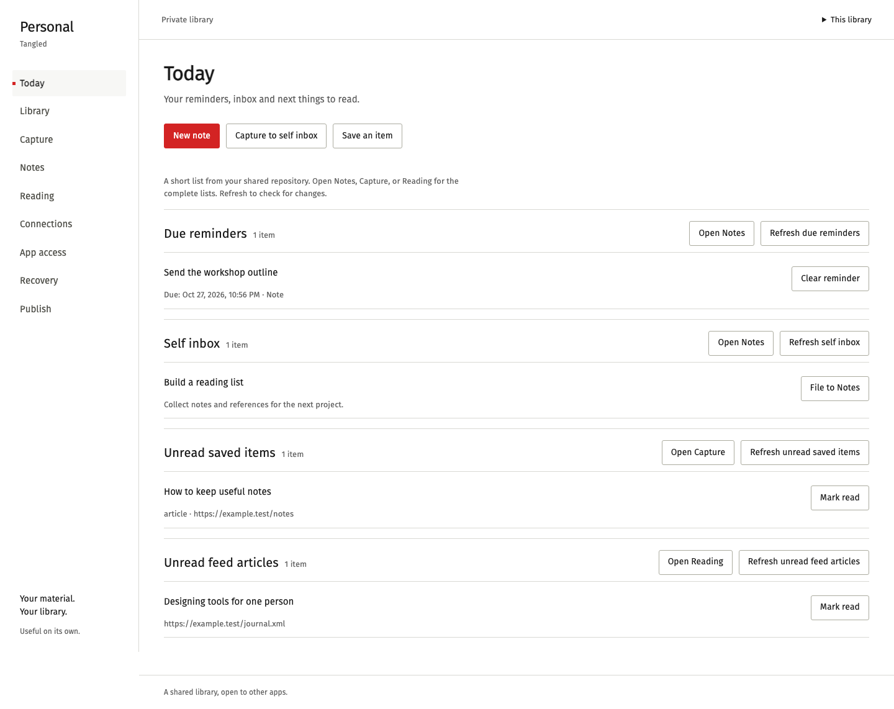

# Tangled

A content-network protocol: Solana-key identity, signed Merkle repositories, capability authorization, sealed records, and normative bridges to other networks.

This repository contains the **version 1 specification**, Rust reference implementations, Personal, Reed, Loomed, Weft, a hosted provider, and a **static documentation site**. The site explains the protocol; the provider and apps run separately. No public network size or production adoption is claimed.

[Run locally](#run-the-complete-local-setup) · [What you can see](#what-you-can-see) · [Repository map](#repository-map) · [Read the spec](#read-the-spec)



*Personal, running locally with sample data. It is useful before you have followers or network peers.*

## How the pieces fit



Personal, Reed, Loomed and Weft are initial clients. Anyone can build compatible
apps using the signed records, open collection schemas and documented APIs.
Personal also exposes a [local API and record links](docs/features/personal-app-api.md)
for independently built interfaces.

The setup below uses **separate data directories and identities** for Personal,
the self-hosted knot and the provider. Starting them together does not synchronize
accounts or copy data between them. The three desktop clients connect to the
self-hosted knot on port 3000; Personal works independently on port 8788.

## Run the complete local setup

### One command with sample data

With Node.js 22+, Rust and the native desktop prerequisites below installed:

```sh
just demo
# Without just: node scripts/local-demo.mjs
```

The command builds the binaries, installs documentation dependencies when missing,
starts all seven processes, and seeds fictional sample data. Personal opens with
reminders, inbox notes, saved articles, a reading queue and a source conversation.
Reed and Loomed open with sample posts and conversations; Weft observes the seeded
knot. The provider opens with a sample public post; demo sign-in details are
printed in the terminal. The documentation opens alongside them.

**Press Enter or Ctrl-C in the launcher to stop everything it started.** Closing
one of the desktop apps also ends the demo. Startup failures stop the other demo
processes. Shutdown sends a graceful termination first, then stops any remaining
owned process groups after a bounded wait. Browser tabs may remain after their
services stop.

Each invocation creates a fresh private `.data/local-demo/run-*` directory and
retains its state and logs after shutdown. Your normal profiles are untouched.
The private Personal launch link and demo account are saved there; keep those
files and terminal output private. If a required port is already
occupied, the launcher exits without stopping the existing listener.

```sh
just demo --no-open                  # Keep browser tabs closed; print links
just demo --no-desktop --no-open      # Services and sample data on a headless host
just demo --port-offset 10000         # Use 13000 / 18788 / 18787 / 14321
just demo --skip-build                # Reuse already-built binaries and site dependencies
```

The managed launcher supports macOS and Linux. Readiness, failure and cleanup
messages stay in the terminal; detailed per-process logs are in the run directory.
For manual control over each process, use the seven-terminal setup below.

### Manual setup

This starts **four services and three desktop windows**. Run every command from
the repository root in Bash/zsh, with each numbered terminal kept open. To try only Personal,
use Terminal 2; it needs none of the other processes.

### Prepare once

Install a compatible stable Rust toolchain and Node.js **22 or later** with npm.
For Reed, Loomed and Weft, follow the
[Dioxus 0.7 platform prerequisites](https://dioxuslabs.com/learn/0.7/getting_started/):
macOS uses its system WebView, Windows needs WebView2, and Linux needs the listed
WebKitGTK and native development packages. See the
[getting-started guide](docs/guides/getting-started.md) for workspace conventions.
The `just` recipe runner is optional for the explicit commands below.

```sh
npm --prefix site ci
cargo build -p tangled-knot -p tangled-personal -p tangled-provider
```

The first native-app build can take longer. Cargo commands share a build lock, so
another terminal may wait for the current compilation to finish.

### Start the four services

**Terminal 1 — self-hosted knot / protocol API**

```sh
cargo run -p tangled-knot -- --listen 127.0.0.1:3000 --data .data/local-knot
```

**Terminal 2 — Personal / private library**

```sh
cargo run -p tangled-personal -- serve --data .data/personal --listen 127.0.0.1:8788
```

The browser normally opens automatically. Use the **exact private launch link**
printed by this process; its session fragment connects the browser to your
library. Keep that link private. Personal opens on Today.

**Terminal 3 — provider / account and archive interface**

```sh
DATA_DIR=.data/provider PORT=8787 PUBLIC_URL=http://127.0.0.1:8787 \
  cargo run -p tangled-provider
```

Open [127.0.0.1:8787](http://127.0.0.1:8787). The provider holds account keys and
private archive content. Its listener currently binds all network interfaces;
`PUBLIC_URL` controls advertised URLs, not the bind address.

**Terminal 4 — documentation site**

```sh
PUBLIC_PROVIDER_URL=http://127.0.0.1:8787 \
  npm --prefix site run dev -- --host 127.0.0.1 --port 4321
```

Open [127.0.0.1:4321](http://127.0.0.1:4321). The landing page's account link now
points to your local provider. This site explains the system; it does not start
the other services.

### Open the three desktop apps

These commands open **native windows**, rather than web pages. The profile
variables keep this setup's local keys and preferences under `.data/apps/`.
Fresh profiles use the knot at `http://127.0.0.1:3000`.

**Terminal 5 — Reed**

```sh
REED_HOME=.data/apps/reed cargo run -p reed --features desktop
```

**Terminal 6 — Loomed**

```sh
LOOMED_HOME=.data/apps/loomed cargo run -p loomed --features desktop
```

**Terminal 7 — Weft**

```sh
WEFT_HOME=.data/apps/weft cargo run -p weft --features desktop
```

### What you can see

| Process | Where to open it | What appears |
| --- | --- | --- |
| **Personal** | Private launch link from Terminal 2, port **8788** | Today, Library, Capture, Notes, Reading, Connections, App access, Recovery and Publish. Save a note or article immediately; a fresh library starts empty. |
| **Reed** | Desktop window from Terminal 5 | Social posts, profiles, follows and timelines. Create/load a local identity and write a post, or add the sample data below. |
| **Loomed** | Desktop window from Terminal 6 | Conversations and circles. Add a local identity and start a conversation, or seed sample DMs and a group below. |
| **Weft** | Desktop window from Terminal 7 | Stats for your local knot and its advertised peers. With one unconfigured knot, the peer list is empty. |
| **Provider** | [127.0.0.1:8787](http://127.0.0.1:8787) | Account signup and sign-in, followed by hosted posts and the private archive/connection interface. Its accounts are separate from the desktop identities. |
| **Knot** | [node.describe](http://127.0.0.1:3000/xrpc/tangled.node.describe) | JSON describing the protocol host. This is an API endpoint, not an app homepage. |
| **Documentation** | [127.0.0.1:4321](http://127.0.0.1:4321) | Landing page, guides, feature docs, protocol specification and interactive explanations. |

Check the running knot from another terminal:

```sh
curl --fail http://127.0.0.1:3000/xrpc/tangled.node.describe
```

### Add sample content

With Terminal 1 still running, seed the **same profiles** used by the desktop
commands. Run these before opening Reed/Loomed, or use Refresh afterward:

```sh
REED_HOME=.data/apps/reed cargo run -p reed-core --bin reed-seed -- \
  --knot http://127.0.0.1:3000 --create-local
LOOMED_HOME=.data/apps/loomed cargo run -p loomed-core --bin loomed-seed -- \
  --knot http://127.0.0.1:3000 --create-local
```

Reed gets sample profiles, posts and follows. Loomed gets DMs and a three-person
group. `--create-local` creates missing keys and retains existing ones.

The [justfile](justfile) groups commands into **Demo**, **Run**, **Seed** and
**Checks**. Use `just demo` for the managed, seeded stack; the old per-app demo
recipes have been replaced by this single entry point. Run `just --list` to see
individual development commands.

For an optional three-knot network topology, run `just weft-seed` and `just weft`
in separate terminals. This uses ports **3000–3002**, so stop the shared knot or
managed demo first. Press **Ctrl-C** in the seed terminal to stop the cluster.

### Stop and restart

Close the desktop windows and press **Ctrl-C** in each service terminal. Keep
`.data/` to retain this setup's libraries, keys, accounts and profiles; it is
Git-ignored. Do not point Personal and a running knot at the same live data
directory. On restarting Personal, use its newly printed launch link.

Live source connectors and the optional Solana/SNS validator are separate from
this local app setup. See [connector setup](connectors/README.md) and the
[SNS instructions](#rust-crates) when you need them.

## Repository map

- Documentation: [`docs/`](docs/) — guides, specifications, and reference sources
- Canonical spec: [`docs/spec/`](docs/spec/)
- Site: [`site/`](site/) — landing at `/`, guides at `/guides`, feature docs at `/docs`, specs at `/spec/…`
- Rust reference client: [`crates/tangled/`](crates/tangled/)
- Knot HTTP server: [`crates/tangled-knot/`](crates/tangled-knot/)
- Hosted provider (account signup, Render blueprint): [`crates/tangled-provider/`](crates/tangled-provider/) — `just provider`
- Personal library: [`apps/personal/`](apps/personal/) — Today, capture, notes, reading, recovery, and deliberate publishing
- Reed social app: [`apps/reed/`](apps/reed/)
- Loomed messenger: [`apps/loomed/`](apps/loomed/)
- Weft network explorer: [`apps/weft/`](apps/weft/)
- Social activity imports: [`docs/features/social-imports.md`](docs/features/social-imports.md) — private archives, Telegram/X/WhatsApp connector setup, recovery, and implementation assumptions.
- Product / visual contracts: [`PRODUCT.md`](PRODUCT.md), [`DESIGN.md`](DESIGN.md)

## Read the spec

```
docs/spec/00-abstract.md … docs/spec/21-changelog.md
docs/spec/cddl/          DAG-CBOR types
docs/spec/schemas/       JSON Schema for core and example collections
docs/spec/http/openapi.yaml
docs/spec/interop/translations.yaml
docs/spec/vectors/       cryptographic fixtures
```

## Site

Landing at `/`. Guides at `/guides` introduce Tangled and setup. Docs at `/docs` explain features. Specs at `/spec/…` define the formal protocol. Preview:

```bash
just docs
# or: cd site && npm install && npm run dev
```

Build is fully static (`npm run build` in `site/`). Search is Pagefind, generated at build time.

GitHub Pages: push to `main` publishes [dodecahedr0x.github.io/tangled](https://dodecahedr0x.github.io/tangled/). First time: repo **Settings → Pages → Source: GitHub Actions**.

## Vectors

```bash
cd docs/spec/vectors
npm install
node generate.mjs
```

Seed is `BLAKE3("tangled-vector-seed-v1")`. MLS payloads in `mls-welcome-commit.json` are synthetic stand-ins for RFC 9420 messages; the Tangled wrapping is normative. The Rust crates produce and verify real OpenMLS Welcome/Commit bytes in tests (not byte-equal to that fixture).

## Rust crates

```bash
cargo test --workspace
cargo run -p tangled -- identity
cargo run -p tangled-knot -- --listen 127.0.0.1:3000 --data ./data
```

Live SNS handle resolution (`getAccountInfo`) is skipped unless `SOLANA_RPC` is set. CI starts `solana-test-validator` (Agave **v4.2.1**) with fixtures; locally:

```bash
# loads crates/tangled/fixtures/sns (same as CI) — not a bare --reset
scripts/sns-validator.sh --bg
SOLANA_RPC=http://127.0.0.1:8899 cargo test -p tangled --test sns_rpc -- --ignored
```

See [`crates/tangled/README.md`](crates/tangled/README.md) (client) and [`crates/tangled-knot/README.md`](crates/tangled-knot/README.md) (knot server).

## License

Specification text and site: Apache-2.0, unless a file says otherwise.
