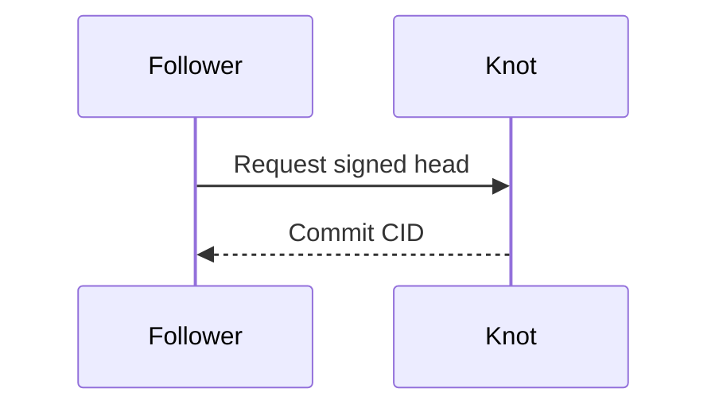

# Documentation

`docs/` is the source of truth for the website's three documentation levels.
Edit these sources and rebuild; keep content out of Astro templates.

## Three levels

| Level | Source | Site | Purpose |
| --- | --- | --- | --- |
| **Guides** | `guides/` | `/guides` | Present Tangled at a high level, orient a new reader, and help them get started |
| **Docs** | `features/` | `/docs` | Explain feature behavior, configuration, examples, failure states, and implementation boundaries in detail |
| **Specs** | `spec/` | `/spec/<slug>` | Define the formal protocol, data formats, verification rules, and conformance requirements |

A reader should be able to move from a guide to the relevant feature docs and
then to the formal specification. Link between levels instead of maintaining
competing definitions of a record, permission, or wire format.

- Put introductions and task-oriented first-run steps in **Guides**. Explain
  unfamiliar concepts in ordinary language; link to Docs for deeper behavior.
- Put feature explanations, examples, settings, and operating limits in **Docs**.
  Distinguish implemented behavior from protocol requirements and planned work.
- Put normative requirements and exact formats in **Specs**. Use RFC requirement
  language there and keep the machine-readable companions consistent.

`features/` is named for its content; the site labels that level **Docs**.
The top navigation switches levels. Each sidebar lists only the selected level's
pages; formal chapters and reference tools appear under **Specs**.
Previous and next links follow that level's sidebar order without wrapping into
another level. Type and HTTP reference detail pages follow their index order
within Specs. The first and last pages omit the unavailable direction.
`spec/e2e/` holds informative reference-implementation acceptance documents, not
additional normative protocol chapters.

## Sources and generated output

| Source | Published output |
| --- | --- |
| `guides/index.md`, `features/index.md` | `/guides`, `/docs` landing pages |
| Other guide and feature Markdown | `/guides/<slug>`, `/docs/<slug>` |
| `spec/00-abstract.md` through `spec/21-changelog.md` | `/spec/<slug>`; terminology also at `/terminology` |
| `spec/cddl/`, `spec/schemas/`, `spec/http/`, `spec/interop/`, `spec/vectors/` | Downloadable companions under `/spec/` |
| `spec/http/openapi.yaml` | Also `/openapi.yaml` and `/reference/openapi` |
| `reference/types.json`, `reference/http.json` | Curated `/reference/types/*` and `/reference/http/*` reading aids |
| Published guides, feature docs, and numbered chapters | Combined `/llms.txt` and Pagefind search |
| `internal/`, `superpowers/`, this README | Repository-only maintenance and planning documents |

Old `/docs/getting-started`, `/compare`, and `/interop` URLs redirect to the
corresponding page in the appropriate level. Formal spec and reference URLs stay
unchanged.

CDDL, schemas, OpenAPI, and normative chapters define the protocol contract.
Curated reference JSON provides summaries and examples; update it alongside the
formal sources when a field or method changes.

## Add or edit a page

Add a `.md` file inside `guides/` or `features/`. Match the filename to its `slug`:

```yaml
---
title: Page title
slug: page-title
description: A short description for the page metadata.
order: 8
---
```

Use `index.md` with `slug: index` for each level's landing page. Give each page
one `#` heading. Astro validates metadata, generates pages and sidebar links, and
derives the table of contents from headings. Use unique slugs and ordering within
each level. Formal chapter metadata also includes `group` for the spec sidebar.

Use relative Markdown links, for example
`[Records and sync](../features/records-and-sync.md)` from a guide, or
`[Synchronization](../spec/11-sync.md)` from feature docs. These work in the
repository and resolve to rendered site pages, preserving fragments and the
GitHub Pages `/tangled` base. Machine assets stay downloadable; source links
outside published docs resolve to the repository.

Put drafts and internal plans in `internal/` or `superpowers/`; those directories
are excluded from publication.

## Mermaid diagrams

Use a fenced `mermaid` block. Its optional label becomes the figure's caption
and accessible label. Explain the flow in nearby prose too.

````markdown

````

Mermaid is bundled locally and renders SVG in the browser, with theme support
and horizontal scrolling for narrow columns. Readable source remains if
JavaScript is unavailable or rendering fails. No CDN is needed.

## Build and verify

```sh
npm --prefix site ci
npm --prefix site test
npm --prefix site run build
npm --prefix site run check:docs
npm --prefix site run preview
```

To verify GitHub Pages paths:

```sh
ASTRO_BASE=/tangled npm --prefix site run build
ASTRO_BASE=/tangled npm --prefix site run check:docs
```

Static endpoints generate raw companions, OpenAPI, and `llms.txt` from these
sources in development and builds. The build adds the Pagefind search index.
