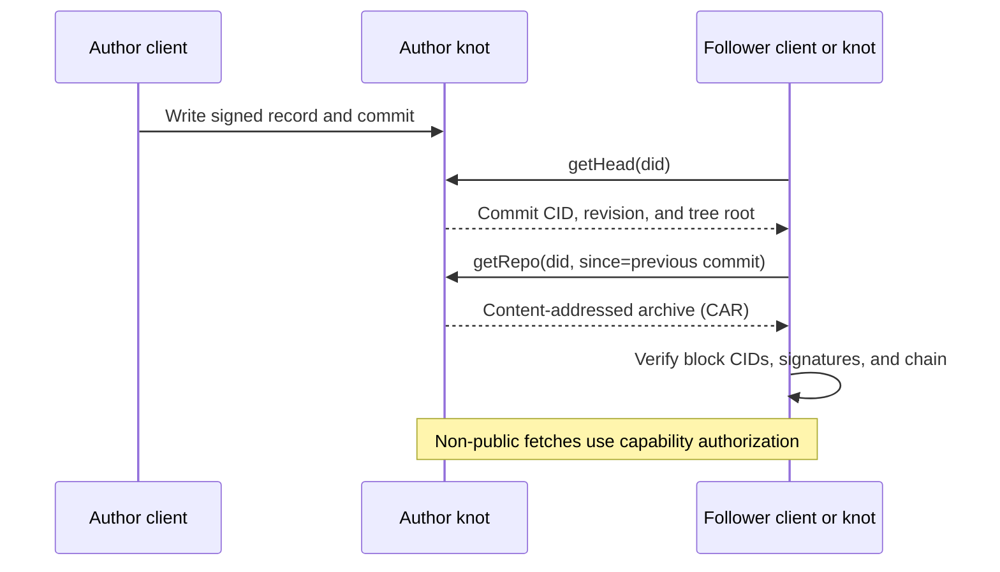

# Records and sync

Tangled stores typed records and opaque blobs. A record's collection tells a
client how to interpret its body. A blob holds file bytes, with access determined
by the records that reference it. Unknown collections can still synchronize;
clients do not need to understand every app's schema to retain its data.

## Records, commits, and content identifiers

Records sit in a Merkle Search Tree (MST). Content identifiers (CIDs) address
encoded blocks by their contents. A signed commit connects an identity, revision,
previous commit, and tree root. The head commit CID and the MST root CID identify
different objects: the head authenticates the repository state; its `data` field
points to the tree.

Clients check block CIDs, signatures, and the commit chain before adopting a new
head. Successful fetching alone does not authenticate a replica. A signature
establishes authorship of the signed data, not the truth of its claims.

## Incremental pull

A follower remembers its last verified head. It requests the current head, then
fetches the changed history and blocks when needed.

`getRepo` returns the public repository. `getRepoAuth` is the authorized variant;
it includes only the scope permitted by the invocation. A `circle/read` grant
does not grant access to unrelated collections. Blobs are not included in an
ordinary repository export unless requested with the relevant option.

Live subscriptions and notifications help a client notice changes. They do not
replace verified pull or make a relay the source of truth.

## Files and authorization

A publicly referenced blob can be fetched without a capability. Otherwise its
fetch requires authorization for the blob or a referencing record. Referencing
the same bytes from both public and sealed records makes that blob public.
Clients that need confidential attachments store encrypted bytes with a distinct
CID. See [Privacy and circles](./privacy-and-circles.md).

## Edits, deletes, and unavailable hosts

A new version records its causal parents. Deletion uses a tombstone; simply
failing to fetch a record is not evidence that its author deleted it. A host can
refuse to serve bytes while a valid replica still retains them.

A lower revision than a previously verified head can indicate rollback or a
recovery race. Clients follow the spec's recovery rules rather than silently
adopting it. Concurrent writes can produce a `ConcurrentHeads` conflict that
requires reconciling against the current signed head.

An unreachable knot means the host cannot currently answer. Previously verified
local history remains evidence of what was received, but does not establish that
no newer history exists.

## Protocol contract

Read [Data model](../spec/06-data-model.md),
[Repositories](../spec/07-repositories.md), and
[Synchronization](../spec/11-sync.md). Exact parameters and responses are in the
[HTTP API](../spec/12-http-api.md) and [HTTP reference](/reference/http).
