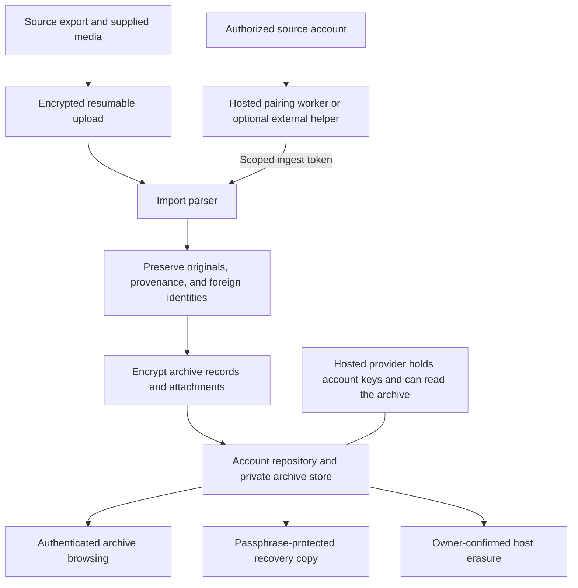

# Social imports

Tangled can keep a private archive of activity from Telegram, Twitter/X, and WhatsApp on a hosted provider or a self-hosted knot. The account's **Your archive & connections** link opens `/imports`. Reed and Loomed settings link to the same account archive.

Imports include other participants' content visible to the source account, not only messages and posts the account authored. Imported senders retain their source identities. They are not invited to Tangled, and imported content is not published to the public network.

## Archive flow



## Import an export

1. Sign into the account on its host and open **Your archive**.
2. Choose the source and enter its stable account identifier. Telegram and X use their numeric user ID; WhatsApp text exports need a consistent account label because they omit native account IDs. When a Telegram/X archive supplies its native account ID, the importer uses it and reports mismatches.
3. Upload the export file. Use a ZIP to include its media directory. The browser sends verified 1 MiB chunks and shows progress. Pause, close the page, or recover from a connection loss, then choose the same file to resume. Cancel removes staged bytes.
4. Browse the aggregated activity, search or filter by source, download available attachments, and inspect **Source data** for preserved fields. Import history lists coverage warnings and an exact original-file download.

| Source | Accepted archives | Readable activity |
| --- | --- | --- |
| Telegram | Desktop JSON, either full export or a single chat; ZIP containing `result.json` and media | Messages from all supplied participants, service events, profile/export metadata, rich text, and supplied media |
| Twitter/X | Official archive ZIP with JSON/static `window.YTD` data files, or individual JSON/JS datasets | Posts, DMs/group DMs, likes, bookmarks, follows/followers, supplied images/videos/GIFs, and retained unknown datasets |
| WhatsApp | Android/iOS exported chat text, or ZIP containing chats and media; UTF-8 and BOM-marked UTF-16 | Multiline messages, group histories, sender names, system events, and supplied media |

X JavaScript export files are parsed as static data; their JavaScript is never executed. Unknown fields, unknown archive files, and exact original uploads are retained rather than dropped because no specialized reader exists.

The current importer limits uploads to 256 MiB, ZIP expansion to 128 MiB total, individual expanded files to 32 MiB, and ZIP entries to 4,096. It rejects unsafe paths, symlinks, duplicate ZIP filenames, corrupt data, and suspicious compression ratios. Larger exports need to be split at the source. Uploads are resumable and staged as encrypted chunks; acknowledged offsets survive host restart. Full-file SHA-256 prevents combining different files. Inactive staging expires after seven days, and each owner may have eight unfinished uploads. Final parsing/import is memory-bounded and runs on a blocking worker; completion is idempotent and returns a durable receipt.

## Connect ongoing activity

Choose **Connect app** on the archive page to sign in through a host-configured pairing service. Telegram asks for the phone number, login code, and two-step password when required; X redirects to its actual OAuth authorization; WhatsApp displays its linked-device QR. The authenticated source account is bound automatically and the host starts an ongoing import worker. The browser receives neither source sessions nor ingest tokens. Missing source application credentials, runtime dependencies, or pairing setup are reported as unavailable.

The provider container bundles the private pairing service, Python/Node runtimes, and process supervision. Self-hosted operators can run the service beside their knot. Its control endpoint is loopback-only and token-authenticated; sessions and checkpoints are encrypted on persistent host storage. See [hosted pairing setup](./hosted-pairing.md). External runners remain optional under **Use an external connector** for people who keep source authorization on another machine.

Use the actual source sign-in in the [connector setup guide](./connectors.md):

- Telegram: user phone/code/optional two-step login, accessible cloud-history backfill, ongoing message/media polling, profile/contact snapshots.
- X: user OAuth2 with PKCE, available posts/replies, legacy DMs, likes, bookmarks, followers/following, profile snapshots, and media. Missing category permissions or API entitlements create explicit incomplete-coverage warnings while other categories continue. API budgets and access must be configured by the operator.
- WhatsApp: experimental personal-account linked-device QR pairing, supplied history sync, new messages, media, contact/chat metadata, and reaction/edit/deletion events. The Business API is not used as a substitute for a personal account.

Source login credentials stay encrypted on the helper machine, outside Tangled records and exports. Destination tokens authorize only one registered account/source connection. Helpers checkpoint after destination acknowledgement, retry bounded transient failures, and stop on invalid tokens. They do not intentionally send posts, messages, reactions, read receipts, or contact changes; source authentication and protocol maintenance still occur.

**Disconnect** stops and removes hosted source sessions, supervised workers, and pending hosted connector state, then revokes destination ingestion. Existing archive history remains. A configured but unreachable pairing service prevents a successful cleanup acknowledgement until retry. External runners retain credentials on their own machine; stop them and revoke source sessions separately in the app's account settings. The host cannot erase remote helper files or source-side device/session listings.

## Privacy, history, and duplicates

Normalized content, provenance, filenames, original exports, and attachments are encrypted before repository storage. The public network receives neither the archive bodies nor attachment bytes. Normal source identifiers are not plaintext record keys. Tangled v1's public commit/MST proofs still reveal opaque sibling keys/CIDs and structural activity; this feature does not claim metadata anonymity.

A hosted provider holds account keys and runs the importing client, so it can read imported content. This is disclosed on the account page. Encryption does not hide that content from its custodial provider.

Native IDs deduplicate archive/live overlap and exact reimports. Source creation time remains separate from local capture time; known timestamp formats sort by their actual instant. Ambiguous WhatsApp local dates and unknown relationship times remain literal/unknown instead of being assigned a fabricated timezone.

WhatsApp text exports have no native message IDs. Exact export reimports remain stable; changed or partially overlapping chat files preserve separate possible-duplicate captures rather than risking loss of identical messages. WhatsApp archive/live deduplication and perfect sender/account verification are not claimed.

Known newer source edits supersede older versions. Conflicting captures without a provable revision order retain their raw data and a coverage warning. Missing-media references are not treated as missing stored blobs: an imported manifest claiming stored bytes must always have complete, decryptable chunks. Reused media filenames cannot overwrite an earlier attachment's bytes.

**Hide from activity** remains a browsing choice with original exports retained. For deletion, use **Erase imported data**, select a source/account or the entire imported archive, and type `ERASE`. Erasure removes host-retained normalized content, original exports/live batches, media, historical private record/blob bytes, indexes, staged uploads, and matching hosted source authorization. Whole-archive erasure also retires the archive key. Native Tangled posts and other owners' data remain intact.

Durable generation/CID/key-fingerprint fences reject stale workers, in-flight requests, old upload completions, and erased backup material after restart. Signed commit/Merkle proof metadata can retain opaque CID references; erased ciphertext cannot be fetched. Failed disk cleanup is retryable. Source erasure cancels all same-app staging because a typed account label cannot prove a pending file's actual account; uploads for other apps remain resumable. This cannot recall external backups, storage snapshots, or source-app content. Independent external-runner credentials require cleanup on their own machine.

## Back up and recover without a provider

Use **Keep a recovery copy** on `/imports`, choose a separate passphrase of at least 12 bytes, and download `tangled-recovery.json`. This contains encrypted archive data and the Tangled account's signing/agreement keys, protected with Argon2id and HPKE. Source-service credentials and ingest tokens are excluded.

Keep the file and passphrase separately. Anyone holding both can read the archive and sign as the Tangled account. This passphrase is not the provider password, and the provider cannot reset it for an already downloaded file. The provider can see the passphrase while generating a hosted backup because it already holds the underlying keys; the file remains independently recoverable afterward.

Recover offline into a new directory:

```sh
umask 077
# Put the recovery passphrase in a private file without adding it to shell history.
cargo run --offline -p tangled-import --bin tangled-import-recover -- \
  /path/to/tangled-recovery.json /path/to/passphrase-file /path/to/new-recovery-directory
```

Recovery produces a private `recovered-account.json`, normalized `activity.json`, exact original exports, an `attachments/` directory with a `files.json` name/type mapping, and an encrypted archive database. Keep that directory private. Its signing/agreement keys are sensitive. Restoring a different archive key onto a nonempty archive is rejected to avoid corrupting existing history.

The older `GET /api/imports/export` endpoint is an account-key-encrypted archive export and requires possession of the agreement key; the passphrase-based `POST` recovery flow is the independent hosted-account backup.

## Change host

The provider move protocol transfers account custody and private archive material through an HPKE-encrypted, destination-bound, resumable handoff. A location-only move preserves the signing/agreement keys and DID. The source fences writes and connector tokens; it wipes custody seeds only after destination persistence and verification are acknowledged. Repeating an interrupted move with the same destination/password resumes retirement.

Source-service sessions and ingest tokens do not migrate. Authorize a new destination connection after the move. The current move transport materializes its encrypted package in memory and has a 60-second request timeout; large installations should test migration capacity before relying on it. Repository CAR export remains available separately.

## Implementation boundaries and validation limits

The current implementation has these boundaries:

1. Maximum available authored **and received** activity is in scope, including group content and media. Access granted by the source bounds coverage.
2. Imports remain private even when the source post was public. Republishing and replying into source apps are separate future actions.
3. Preserve original evidence and foreign identities; do not invent Tangled users or source signatures.
4. Prefer uncertain duplicate candidates over silently losing distinct WhatsApp messages. Preserve source time uncertainty.
5. Hosted pairing uses an operator-configured private native source service and encrypted supervised workers. Source authentication happens in the account page; external helpers remain optional. Telegram/X require operator application credentials, while WhatsApp requires the pinned runtime and the owner's QR scan.
6. Centralize private browsing in the account archive. Reed/Loomed link to it rather than copying imported messages into native conversations or public timelines.
7. Use owner-only HPKE archive collections and an encrypted local materialization store, not a new public bridge envelope or native multi-member messaging circle. Circle membership and multi-epoch messaging interoperability are not claimed for this archive model.
8. Transfer supports encrypted persistent chunks, digest/offset verification, pause/cancel/resume, and idempotent completion. Final parsing remains memory-bounded; host-wide storage/API-budget scheduling is outside this implementation. Browser persistence contains only upload ID, digest, and size, never source credentials or file bytes.
9. Full erasure applies to copies and credentials controlled by this host and its configured pairing service. It cannot erase source accounts, external helpers, downloaded backups, storage-system snapshots, or opaque signed proof metadata. Same-app upload staging is conservatively canceled; other apps' uploads survive.
10. No production deployment, real source login, API purchase, or account authorization was performed during development. WhatsApp remains experimental. Source compatibility and actual historical/media coverage need validation with account owners.

Automated checks cover representative archive formats, malformed/unsafe exports, repeated/overlapping content, native-ID/revision reconciliation, immutable media, private access, raw-block authorization, connector protocol/checkpoint behavior, provider migration/retry/acknowledgement, independent recovery, formatting, and strict clippy. These checks do not establish that third-party services will expose all historical data.
