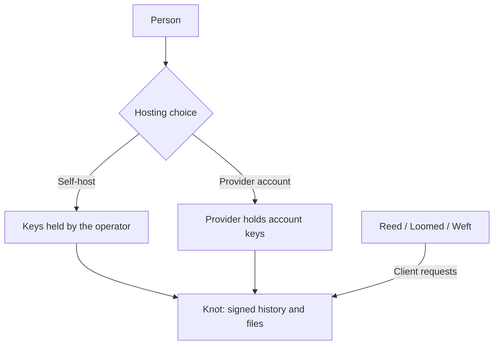

# How Tangled works

Tangled keeps posts, messages, and files in one signed store. Your identity is a
key. A host called a **knot** keeps the store and answers requests from apps.
Other people fetch copies of what you make available to them.

Start with [Getting started](./getting-started.md) to run a local host and try the
apps. The [feature docs](../features/index.md) explain how each part behaves;
[specs](../spec/00-abstract.md) define the formal protocol.

## Choose where your account lives

You can run a knot yourself or use an operated provider. A self-hosted knot puts
key custody and storage under your control. The provider implementation creates
an account's identity and holds its keys, so it can act for the account and read
its private archive. The static documentation site does not host accounts.

The [hosting and identity docs](../features/hosting-and-identity.md) explain keys,
handles, provider custody, and moving between hosts.

## Use the same store through different apps

- **Reed** is for public posts, profiles, follows, and a timeline.
- **Loomed** is a messenger client for sealed conversations.
- **Weft** is a read-only explorer of public counts, connections, and identities.

They are clients of the same protocol. A private message does not become public
because another app can connect to the host. Read the
[app docs](../features/apps.md) for the different views and host configuration.

## Decide who can fetch and read

Public records are available to anyone. Restricted records require a certificate
that authorizes the request. Sealed records are encrypted as well: permission to
fetch their bytes does not by itself reveal the message.

A **circle** groups people who share access to messages. Apps present people and
conversations, rather than asking you to choose an encryption suite. The
[privacy and circles docs](../features/privacy-and-circles.md) explain the
boundaries, including what the host can still see.

## Follow by fetching

Followers pull signed history and the blocks they need. An optional live update
can signal a change. The signatures let a replica check the history instead of
trusting the computer that supplied it. See
[Records and sync](../features/records-and-sync.md) for the detailed flow.

## Bring existing activity

The account archive accepts Telegram, X, and WhatsApp exports. Separately
operated helpers can import ongoing activity with source-account authorization.
Imported content keeps its foreign identities and remains private; it is not
republished to a public graph. [Social imports](../features/social-imports.md)
describe formats, recovery, and current coverage limits.

## Choose your next level

| Level | What you will find | Start here |
| --- | --- | --- |
| Guides | Introductions, setup commands, and orientation | [Getting started](./getting-started.md) |
| Docs | Feature behavior, examples, configuration, and implementation limits | [Feature overview](../features/index.md) |
| Specs | Formal data formats, requirements, APIs, and conformance | [Protocol abstract](../spec/00-abstract.md) |

The repository contains reference programs and deployment configuration. It does
not establish production adoption or independent conformance certification.
